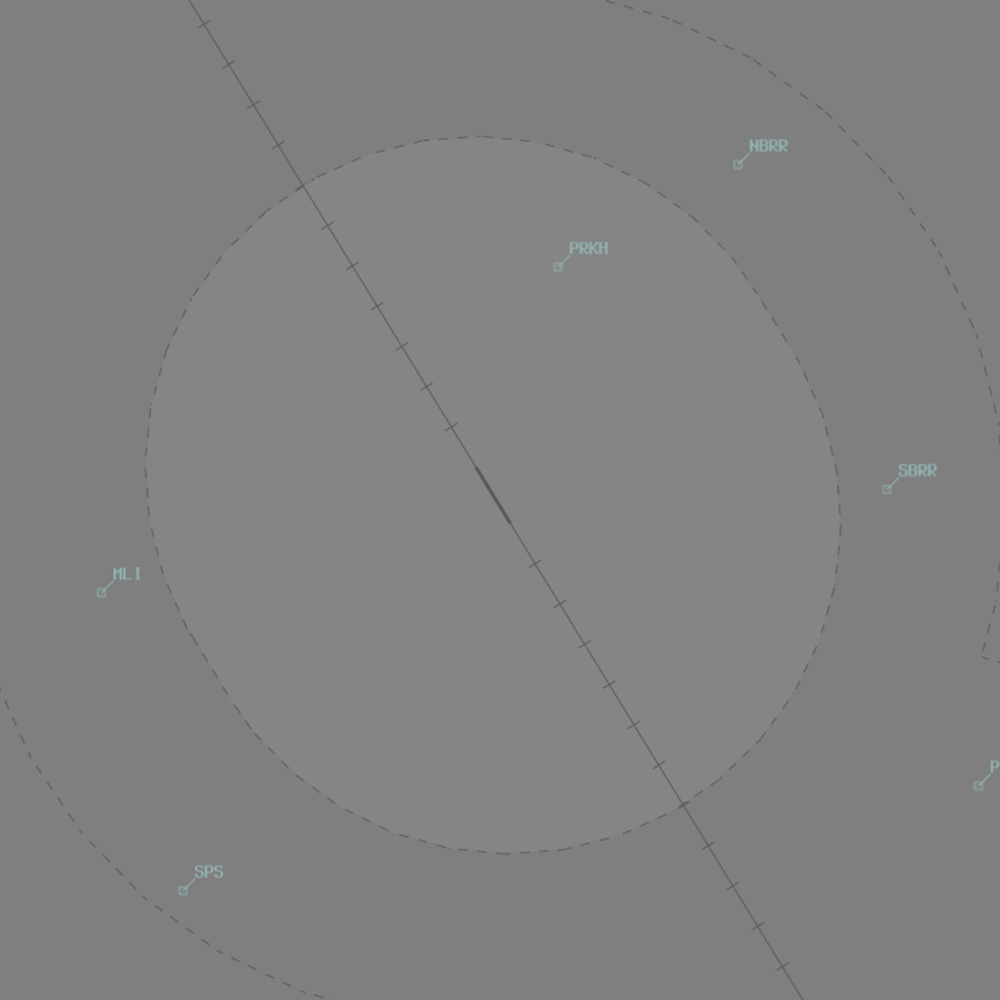
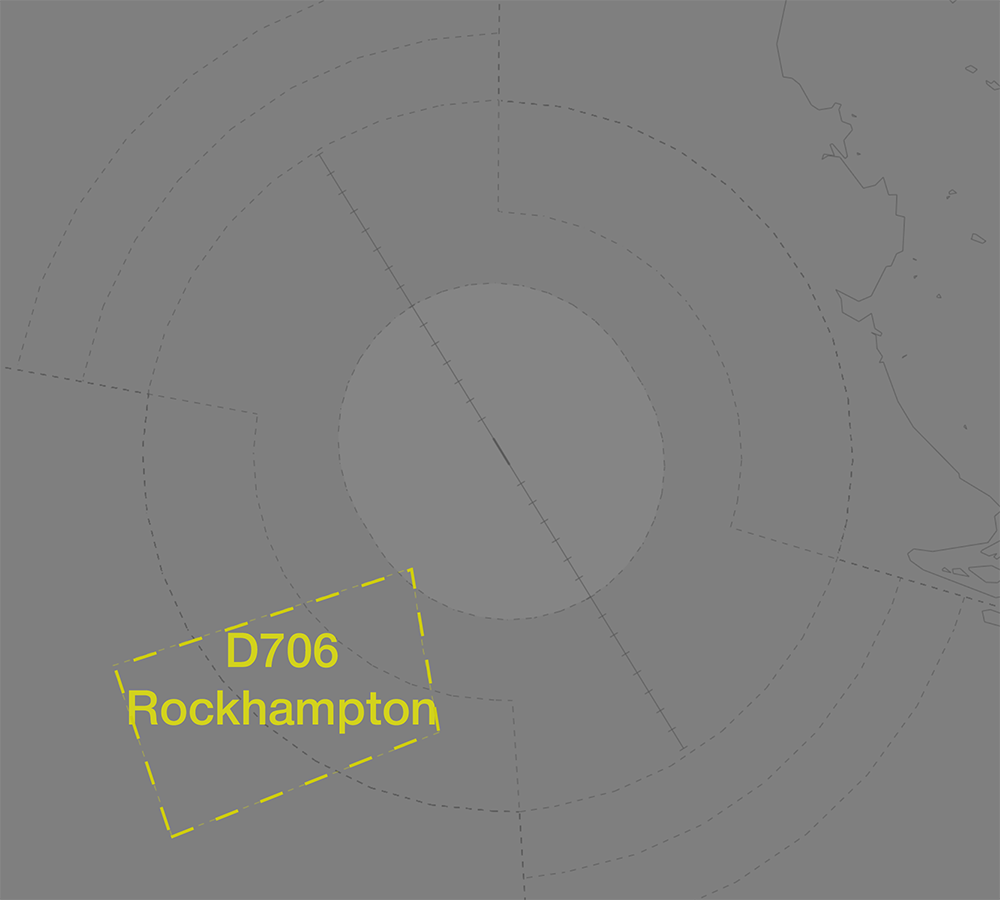

--8<-- "includes/abbreviations.md"

## Positions

| Name                 | Callsign              | Frequency   | Login ID      |
| -------------------- | --------------------- | ----------- | ------------- |
| **Rockhampton ADC**  | **Rocky Tower**       | **118.100** | **RK_TWR**    |
| **Rockhampton SMC**  | **Rocky Ground**      | **121.800** | **RK_GND**    |
| **Rockhampton ATIS** |                       | **128.500** | **YBRK_ATIS** |

## Airspace
RK ADC is responsible for the Class D airspace in the RK CTR `SFC` to `A010`.

<figure markdown>
{ width="700" }
</figure>

Refer to [Class D Tower Separation Standards](../../../separation-standards/classd) for more information.

## Local Procedures
### Initial and Pitch
The [initial points](../../../controller-skills/military/#initial-and-pitch) are at 5NM final, aligned with Runway 15 and 33. Aircraft will arrive via a straight initial at `A020`.

### Training Area Clearances
The D706 Rockhampton [danger area](../../../controller-skills/sua/#danger-areas) is a commonly used training area south-west of YBRK.

<figure markdown>
{ width="700" }
</figure>

Aircraft departing to the training area should be cleared to track to, and operate within, the training area not above `A045`. This clearance gives aircraft permission depart the RK CTR, and transit to the D764 danger area via SPS.

!!! phraseology
    **ABC**: "Rocky Tower, ABC, at runway 33, for the Training Area, ready.”    
    **RK ADC**: "ABC, track to and operate within the Training Area, not above `A045`. Make left turn, runway 33, cleared for takeoff."    

!!! note
    Aircraft tracking direct to the training area do not meet the requirements for [auto release](#auto-release). These aircraft must be 'Next' coordinated with RK TCU.

## Helicopter Operations
### Helipads
There are two helipads at YBRK. The **Eastern Helipad**, located adjacent the GA Apron on Taxiway L, and the **Western Helipad**, located at the end of Taxiway N.

The helipads are part of the manoeuvring area and controlled by RK ADC. Any helicopter taking off or landing on the helipad requires a specific takeoff or landing clearance from ADC.

!!! phraseology 
    **RK ADC**: "CHOP11, Western Helipad, cleared to land."  
    
Helicopters may also request clearance to land on Taxiway N. RK ADC will provide takeoff or landing clearance following [appropriate coordination with SMC](../../../controller-skills/coordination/#helicopter-operations-in-smc-jurisdiction).

## SID Selection
Aircraft planned via **BUDGI** and **TARES** shall be assigned the **Procedural SID** that terminates at the appropriate SID terminus. Aircraft tracking to the north or south and **not** planned via any of these waypoints shall receive amended routing via the most appropriate SID terminus, unless the pilot indicates they are unable to accept a Procedural SID.

Military aircraft shall be assigned either the **Radar SID** or a visual departure.

Aircraft that are unable to accept a Procedural SID shall be assigned the **Radar SID**.

## Runway Modes
#### Circuit Direction
| Runway | Direction |
| ------ | ----------|
| 15     | Right     |
| 33     | Left      |

## Coordination
### Departures
#### Auto Release
[Next](../../controller-skills/coordination.md#next) coordination is **not** required to **RKA** for aircraft that are: 

- Departing from a runway nominated on the ATIS; and  
- Assigned the standard assignable level; and  
- Assigned a **Procedural** SID; or  
- Not entering RKA CTA

The standard assignable level from **RK ADC** to **RKA** is:

| Aircraft | Level |
| ---- | ---- |
| All | The lower of `A060` and `RFL` |

### SMC to RK TCU
The controller assuming responsibility of **SMC** shall give [heads-up](../../../controller-skills/coordination/#airways-clearance) coordination to RKA (or the enroute controller responsible for the RK TCU) prior to the issue of a clearance to an aircraft intending to operate in an SUA that **has not** been activated. 

!!! phraseology
    **RK SMC** -> **RKA**: "PATR11 requests clearance to M678.”  
    **RKA** -> **RK SMC**: "PATR11, clearance approved."

### Arrivals/Overfliers
RKA will heads-up coordinate arrivals/overfliers from Class C to RK ADC.  
IFR aircraft will be cleared for the coordinated approach (Instrument or Visual) prior to handoff to RK ADC, unless RK ADC nominates a restriction.  
VFR aircraft require a level readback.

!!! phraseology
    **RKA** -> **RK ADC**: "Via SARUS for the visual approach, VJN”  
    **RK ADC** -> **RKA**: "VJN, visual approach"  
