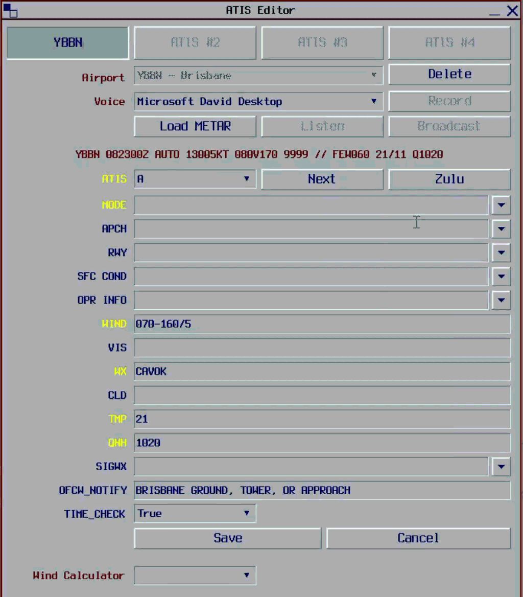
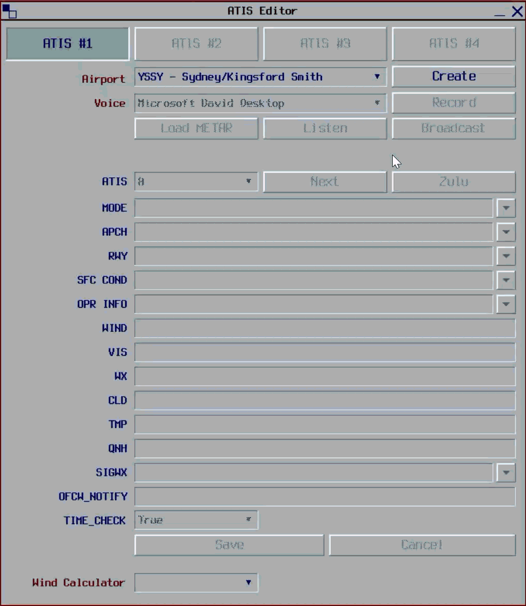
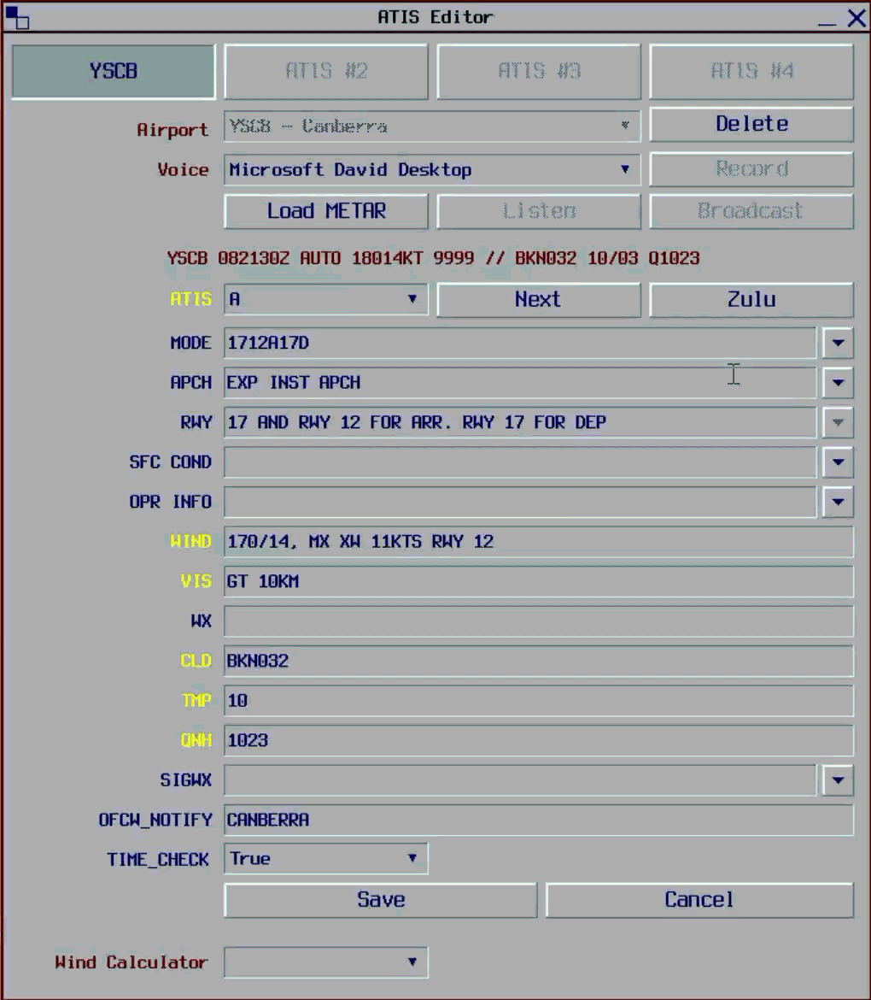
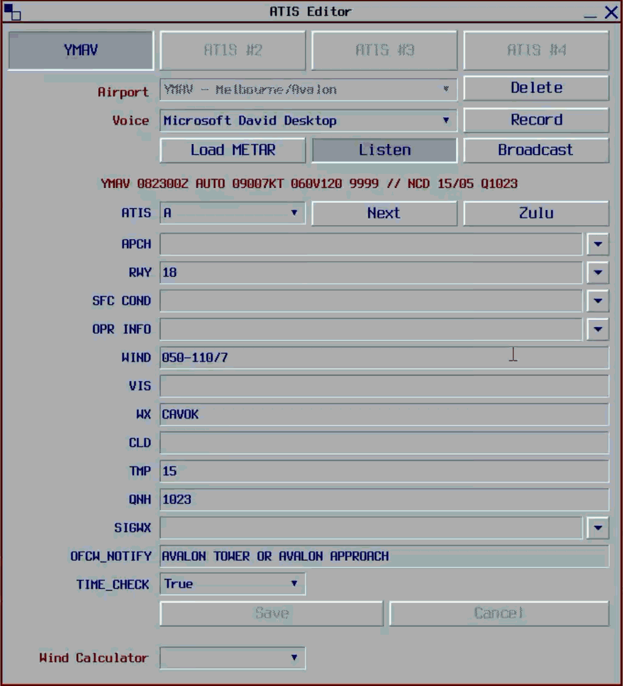

--8<-- "includes/abbreviations.md"

The ATIS Editor plugin allows controllers to create and configure ATISes for up to four aerodromes and offers additional functionality to make it easier to create compliant and realistic ATISes.

## Runway Mode Options
For aerodromes with SOP-defined [preferred runway modes](../../controller-skills/runwaymanagement/#preferred-runway-modes), the ATIS Editor provides a dropdown list of the runway modes which, when selected, populates the `APCH`, `RWY`, and `OPR INFO` fields with the appropriate values.

<figure markdown>
{ width="600" }
</figure>

The list is dynamically reorders itself from most preferred to least preferred, based on the aerodromes' local SOPs and weather.

### Preselected Runway Modes
When the ATIS Editor is first opened, or an update to the METAR is received, the ATIS Editor will pre-select an appropriate runway mode based on the winds, weather, and local SOPs.

<figure markdown>
{ width="600" }
</figure>

!!! tip
    The mode preselection is only a recommendation to assist controllers selecting an appropriate runway mode. Controllers are not obligated to use the pre-selected runway mode, and can use their discretion to choose an alternative runway mode when appropriate.
	
### Runway Mode Warnings
The ATIS Editor will highlight fields when it detects that an ATIS configuration might be invalid.

<figure markdown>
{ width="600" }
</figure>

| ATIS Field | Highlight | Description |
| ---------- | --------- | ----------- |
| `RWY`      | Orange    | The crosswind/tailwind components on the selected runway or runway mode exceed limits. |
| `APCH`     | Red       | The selected approach is incompatible with the weather. |

## Operational Info Options
The ATIS Editor provides a dropdown list of the common `OPR INFO` values which provide standardised formatting for messages such as advanced runway configuration changes, [SUA activations](../../controller-skills/sua), and other relevant messages.

<figure markdown>
{ width="600" }
</figure>