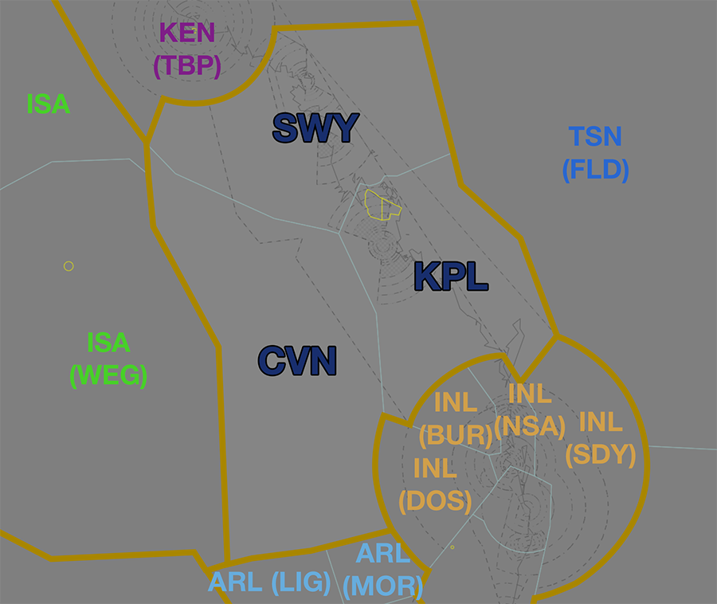
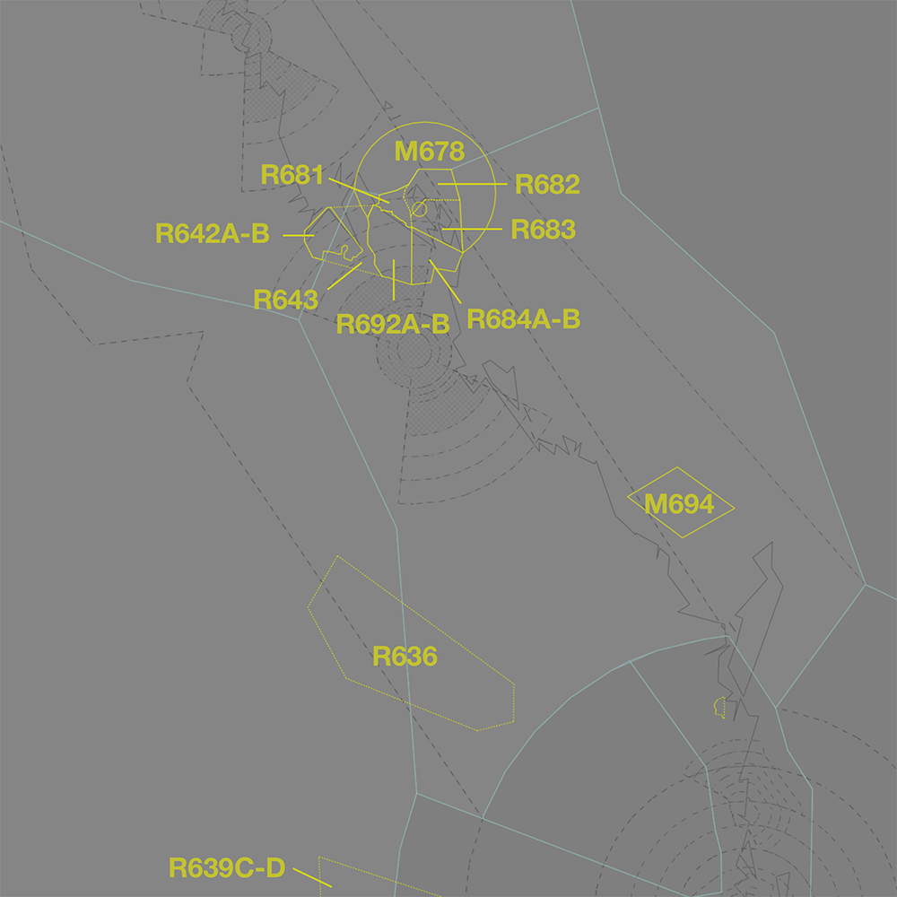

--8<-- "includes/abbreviations.md"
## Positions

| Name              | ID      | Callsign            | Frequency   | Login ID       |
| ----------------- | ------- | ------------------- | ----------- | -------------- |
| **Keppel**        | **KPL** | **Brisbane Centre** | **125.900** | **BN-KPL_CTR** |
| Carnarvon :material-information-outline:{ title="Non-standard position"} | CVN | Brisbane Centre | 133.800 | BN-CVN_CTR |
| Swampy :material-information-outline:{ title="Non-standard position"}    | SWY | Brisbane Centre | 133.200 | BN-SWY_CTR |

!!! abstract "Non-Standard Positions"
    :material-information-outline: Non-standard positions may only be used in accordance with [VATPAC Air Traffic Services Policy](https://vatpac.org/publications/policies){target=new}.  
    Approval must be sought from the **bolded parent position** prior to opening a Non-Standard Position, unless [NOTAMs](https://vatpac.org/publications/notam){target=new} indicate otherwise (eg, for events).

## Airspace

<figure markdown>
{ width="700" }
  <figcaption>Keppel Airspace</figcaption>
</figure>

KPL is responsible for the [RK TCU](../../../terminal/coral) when **RKA** is offline.  
SWY is responsible for the [MK TCU](../../../terminal/coral) when **MKA** is offline.  
KPL is responsible for **SWY** and **CVN** when they are offline.  

### Reclassifications
=== "HM CTR"
	When **HM ADC** is offline, HM CTR (Class D `SFC` to `A045`) reverts to Class G, and is administered by SWY. Alternatively, SWY may provide a [top-down procedural service](../../../aerodromes/procedural/hamiltonisland/) if they wish (not recommended).

=== "MK CTR"
	Whilst the **MKA** controller is expected to provide a [top-down service](../../../aerodromes/classd/mackay/) to YBMK when **MK ADC** is offline, this is not expected of a SWY controller when both **MKA** and **MK ADC** are offline. If electing not to provide a top-down service to YBMK, the RK CTR Class D is reclassified to Class G `SFC` to `A007`, and Class E `A007` to `A045`.

=== "RK CTR"
	Whilst the **RKA** controller is expected to provide a [top-down service](../../../aerodromes/classd/rockhampton/) to YBRK when **RK ADC** is offline, this is not expected of a KPL controller when both **RKA** and **RK ADC** are offline. If electing not to provide a top-down service to YBRK, the RK CTR Class D is reclassified to Class G `SFC` to `A007`, and Class E `A007` to `A045`.

!!! tip
	If choosing *not* to provide a top down service, consider publishing a pre-formatted **ATIS Zulu** for the aerodrome, to inform pilots about the airspace reclassification.

## Departure and Arrival Procedures
### YBHM
#### Sequencing
All sequencing is performed by SWY.

### YBMK
#### STAR Assignment
The following subsectors are responsible for issuing STAR clearance.

| Subsector | STAR | Type | Notes |
| ---- | ----- | -------- | ----- |
| KPL  | WELKE | All | Descent not below `F160` |
| SWY  | DAGSI | All |  |

Arrivals from the south shall be given initial descent to not below `F160`. **SWY** will issue final descent.

### YBRK
#### STAR Assignment
The following subsectors are responsible for issuing STAR clearance.

| Subsector | STAR | Type | Notes |
| ---- | ----- | -------- | ----- |
| KPL  | DADBO | All | |
| SWY  | ABVAS | All | Descent not below `F160` |

Arrivals from the north shall be given initial descent to not below `F160`. **KPL** will issue final descent.

### YBSU
#### STAR Assignment
The following subsectors are responsible for issuing STAR clearance.

| Subsector | STAR | Type | Notes |
| ---- | ----- | -------- | ----- |
| KPL  | REBEG SEBVA | All | Descent not below `F190` |

Arrivals from the north shall be given initial descent to not below `F190`. **INL (NSA)** will issue final descent.

#### Sequencing
KPL is responsible for initial sequencing for aircraft arriving from the north. Final sequencing actions are performed by INL(NSA). Coordination with INL(NSA) should be conducted to ensure that aircraft from each sector are sequenced appropriately with each other.

### YBTL
#### STAR Assignment
The following subsectors are responsible for issuing STAR clearance.

| Subsector | STAR | Type | Notes |
| ---- | ----- | -------- | ----- |
| SWY  | POROB VOMPA | All   | Descent not below `F190` |

Arrivals from the south shall be given initial descent to not below `F190`. **KEN (TBP)** will issue final descent.

#### Sequencing
SWY is responsible for initial sequencing for aircraft arriving from the south. Final sequencing actions are performed by KEN(TBP). Coordination with KEN(TBP) should be conducted to ensure that aircraft from each sector are sequenced appropriately with each other.

## Local Procedures
### Special Use Airspace
There are multiple volumes of [SUA](../../controller-skills/sua) within KPL airspace, mostly associated with military operations around the Shoalwater Bay military training area.

<figure markdown>
{ width="700" }
  <figcaption>Notable SUA in KPL Airspace</figcaption>
</figure>

RK TCU must [give heads up coordination](../../terminal/coral/#sua-in-enroute-airspace) with the relevant enroute controllers **prior** to any departures intending to operate in a currently inactive SUA.

!!! phraseology
    **RKA** -> **KPL**: "On the groud YBRK, PATR11, requests activation of M678 `A085-F240`, from 0300 until 0500.”  
    **KPL** -> **RKA**: "PATR11, expect activation of M678 `A085-F240` at 0300 until 0500."   
    **RKA** -> **KPL**: "PATR11."   
    
Non-participating aircraft intending to transit an activated SUA should be rerouted, where possible, [subject to the VATSIM Code of Conduct](../../controller-skills/sua/#ad-hoc-activations).

#### Shoalwater Bay SUA
The Shoalwater Bay Military Training Area is contained within multiple volumes of SUA:

- M678 Shoalwater Bay (`NOTAM`-`NOTAM`)
- R642A-B Mt Wellington (`SFC`-`A060`)
- R643 Shoalwater Bay West (`A020`-`A060`)
- R681 Akens Island (`NOTAM`-`NOTAM`)
- R682 Townshend Island (`NOTAM`-`NOTAM`)
- R683 Cape Clinton (`NOTAM`-`NOTAM`)
- R684A-B Mount Hummock (`SFC`-`NOTAM`)
- R686 Triangular Island (`SFC`-`F160`)
- R692A-C Raspberry Creek (`SFC`-`NOTAM`)

The area is used for extensive army training and operations based at [YBRK](../../aerodrome/classd/rockhampton), Samuel Hill (YSMH), and Williamson (YWIS). R681-R684 and R692 are wholly located in the KPL subsector, while the rest extend across both KPL and SWY.

##### Affected Civil Operations
When activated these SUA significantly disrupt traffic on the busy **Q67** and **Y32** high altitude airways, including arrivals to YBMK, YBPN, and YBTL from the south.

| Planned Airway | ERSA Recommended Rerouting |
| -------------- | -------------------------- |
| Q67  | `.. Q67 GLA RK TARES NOLUP OVRON Q67 ...` |
| V308 | `.. V308 RK TARES WELKE V308 ...` |

!!! note
	 Aircraft tracking via a recommended rerouting must still be [separated from the SUA](../../controller-skills/sua/#separation-from-sua) laterally and vertically. After amending flight plans for the purposes of rerouting around SUA, controllers should ensure the route is displayed visually and the BRL is used to measure for [>2.5nm](../../controller-skills/sua/#controlled-airspace) clearance with all parts of the SUA.

#### M694
The M694 Elliott [MOA](../../controller-skills/sua/#military-operating-areas) are located northeast of YBUD, `NOTAM-NOTAM`, entirely within KPL airspace. The SUA is used for a variety of different naval activities.

#### Amberley SUA
The R636 Gayndah [restricted area](../../controller-skills/sua/#restricted-areas) is located west of YGAY, `A070`-`F230` in both CVN and KPL airspace. The airspace is associated with military activity based at [Amberley](../../terminal/amberleyoakey), as is the R639C-D restricted area which clips CVN airspace in the south-eastern corner.

AMA (or INL(DOS) on their behalf) will coordinate the activation of these SUA **prior** to any activity.

## STAR Clearance Expectation
### Handoff
Aircraft being transferred to the following sectors shall be told to Expect STAR Clearance on handoff:

| Transferring Sector | Receiving Sector | ADES | Notes |
| ---- | -------- | --------- | --------- |
| KPL, CVN | INL(BUR/DOS) | YBBN, YBCG | |
| KPL | SWY | YBTL | |
| SWY | KPL | YBSU | |
| SWY | KEN(TBP) | YBCS | |

!!! tip
    Due to the proximity of the border with INL(BUR) to YBBN/YBCG, KPL should endeavour to handoff aircraft to INL(BUR) **as soon as possible**, ie, **>50nm** to the boundary if there are no restrictions.

## Terminal Handover Frequencies
Each of the Coral TCUs has its own frequency. When a controller is [extending](../../../controller-skills/extending/#terminal-area) to cover both TCUs both frequencies will be primed but the callsign remains the same.

| TCU | Frequency (Controller) |
| ---- | --------------------- |
| MKA | **125.650** (MKA)      |
| RKA | **123.750** (RKA)      |

## Coordination
### RKA
#### Airspace
RKA is responsible for the airspace within the 'RK keyhole' `SFC` to `F150`.

Refer to [Reclassifications](#reclassifications) for operations when RKA is offline.

#### Arrivals/Overfliers
Voiceless for all aircraft:

- With ADES **YBRK**; and  
- Assigned the **ABVAS** or **DADBO** STAR; and  
- Assigned `A090`

All other aircraft coming from KPL CTA must be **Heads-up** Coordinated to RKA prior to **20nm** from the boundary.

#### Departures
Voiceless for all aircraft:

- Tracking via **BUDGI** or **TARES**; and  
- Assigned the lower of `F150` or the `RFL`

All other aircraft going to KPL CTA will be **Heads-up** Coordinated by RKA.

### MKA
#### Airspace
MKA is responsible for the airspace within the 'MK keyhole' `SFC` to `F150`.

Refer to [Reclassifications](#reclassifications) for operations when MKA is offline.

#### Arrivals
Voiceless for all aircraft:

- With ADES **YBMK**; and  
- Assigned the **DAGSI** or **WELKE** STAR; and  
- Assigned `A090`

All other aircraft coming from SWY CTA must be **Heads-up** Coordinated to MKA prior to **20nm** from the boundary.

#### Departures
Voiceless for all aircraft:

- Tracking via **CLIFT** or **MUNAR**; and  
- Assigned the lower of `F150` or the `RFL`

All other aircraft going to SWY CTA will be **Heads-up** Coordinated by MKA.

### Enroute
As per [Standard coordination procedures](../../../controller-skills/coordination/#enr-enr), Voiceless, no changes to route or CFL within **50nm** to boundary.

### KPL Internal
As per [Standard coordination procedures](../../../controller-skills/coordination/#enr-enr), Voiceless, no changes to route or CFL within **50nm** to boundary.

Additionally, changes to CFL are permitted up to the boundary between KPL and SWY, for the purposes of issuing descent in to YBRK and YBMK.

### HM ADC
#### Airspace
HM ADC is responsible for the Class D airspace in the HM CTR `SFC` to `A045`.

Refer to [Reclassifications](#reclassifications) for operations when HM ADC is offline.

#### Departures
[Next](../../controller-skills/coordination.md#next) coordination is required from HM ADC to SWY for all aircraft **entering SWY CTA**.

The standard assignable level from **HM ADC** to **SWY** is:

| Aircraft | Level |
| ---- | ---- |
| All | The lower of `A050` and `RFL` |

#### Arrivals/Overfliers
YBHM arrivals and overfliers shall be heads-up coordinated to **HM ADC** from SWY prior to **5 mins** from the boundary.

!!! phraseology
    **SWY** -> **HM ADC**: "Via OPOSI for RNP-U, JST848”  
    **HM ADC** -> **SWY**: "JST848, A060"  

The standard assignable level from SWY to HM ADC is `A060`, any other level must be prior coordinated.

### TSN(HWE/FLD) (Oceanic)
As per [Standard coordination procedures](../../../controller-skills/coordination/#pacific-units), Voiceless, no changes to route or CFL within **15 mins** to boundary.

Aircraft must have their identification terminated and be instructed to make a position report on first contact with the next (procedural) sector.

!!! phraseology
    **INL**: "QFA121, identification terminated, report position to Brisbane Radio, 126.45"