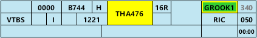
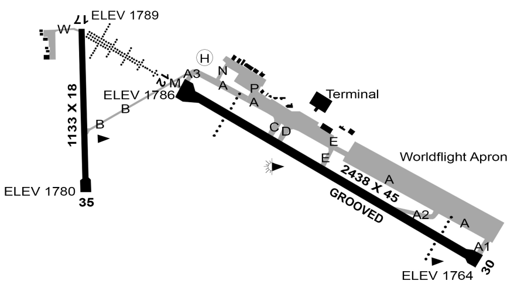

--8<-- "includes/abbreviations.md"

## Temporary Positions
### Aerodrome Controllers
**AS SMC**, a temporary Ground position, is responsible for all of the functions of SMC during the event. They have jurisdiction over all taxiways.

**AS ACD**, a temporary Delivery position, is responsible for all of the [functions of ACD](#airways-clearance-delivery-acd) during the event.

| Name                   | Callsign              | Frequency   | Login ID      |
| ---------------------- | --------------------- | ----------- | ------------- |
| **Alice Springs SMC**  | **Alice Ground**      | **119.900** | **AS_GND**    |
| **Alice Springs ACD**  | **Alice Delivery**    | **126.800** | **AS_DEL**    |

### Terminal Airspace
For the duration of the event, YBAS will be reclassified as a Class C Radar Tower. **AS ADC is not responsible for any airspace**.

All existing Class D airspace is reclassified as Class C and two temporary surveillance TCU units are responsible for the airspace within 36 DME (39 DME to the southeast) from `SFC` to `F185`. 

#### Runway 12
The TMA is split perpendicular to the extended runway centreline. **AS APP** is responsible for the airspace to the west, **AS DEP** is responsible for the airspace to the east.

#### Runway 30
The TMA is split along the extended runway centreline. **AS APP** is responsible for the airspace to the south, **AS DEP** is responsible for the airspace to the north.

## Runway Modes
Single runway operations on either **runway 12 or 30** will be in use for all aircraft.

**Runway 12** is the preferred runway mode.

Runway 17/35 is only available for non-event aircraft by pilot request, or at the discretion of ATC.

## Workload Management
Due to the high workload expected for all positions, the use of the OzStrips plugin for managing aerodrome positions is **mandatory**. Controllers should familiarise themselves with the plugin and the VATPAC [recommended workflow](../../../client/towerstrips.md#workflow).

!!! tip
    The following OzStrips [keyboard shortcuts](../../../client/towerstrips.md#keyboard-shortcuts) may assist controllers managing busy frequencies:

    - `T`: Selects the strip of the last aircraft to transmit on frequency  
    - `W`: Highlight the strip of the last aircraft to transmit on frequency

## Airways Clearance Delivery (ACD)
### Flight Plan Compliance
Ensure **all flight plans** are checked for compliance with the approved WorldFlight route:

!!! note "Official Route"
    YBAS-YSSY: `AS A576 APOMA Y52 GUVBO Y105 TARAL Y59 RIVET`

**OzStrips** will flag any *non-compliant* WF route.

If an aircraft has filed an *incorrect* route and you need to give an amended clearance, this amendment must be specified by **individual private message**, prior to the PDC.

!!! phraseology
    *"AMENDED ROUTE CLEARANCE. DCT AS A576 APOMA Y52 GUVBO Y105 TARAL Y59 RIVET DCT. READBACK AMENDED ROUTE IN FULL DURING PDC READBACK. STANDBY FOR PDC."*

### WorldFlight Teams
WorldFlight Teams will be highlighted by OzStrips and should receive priority at all stages of flight.

<figure markdown>
{ width="500" }
<figcaption>WF Team Highlight in OzStrips</figcaption>
</figure>

### SID Selection
Normal [SID selection](../../../aerodromes/procedural/alice.md#sid-selection) shall apply to all departures. Event aircraft will be assigned the **KALUG SID**.

### Standard Assignable Level
The [standard assignable level](#auto-release) has been changed for the event. All aircraft must be assigned the lower of RFL and `A060`.

### Departure Frequency
The departure frequency for all aircraft shall be AS DEP (**122.4**).

### PDCs
PDCs will be in use by default, to avoid frequency congestion. ACD shall send a PDC to each aircraft as they connect, prioritising those who connected first. Upon successful readback of the PDC, ACD shall direct the pilot to contact SMC when ready for pushback or taxi.

The [PDC Indicator](../../../client/towerstrips.md#strips) will be displayed on a strip when a PDC has been sent to that pilot.

!!! tip
    OzStrips displays strips in the Preactive bay ordered by connection time. Aircraft who connected first are shown down the bottom of the bay.

Work through the OzStrips Preactive bay from *bottom to top* when sending PDCs.

## Surface Movement Control (SMC)
### Temporary Aprons & Taxiways
A temporary **WorldFlight Apron** has been established between the main apron and the runway 30 threshold. 

Taxiway A has been extended to both the runway 12 & 30 thresholds and a temporary rapid exit has been added to runway 12 between taxiway E and the runway 30 threshold.

<figure markdown>
{ width="800" }
<figcaption>Temporary Aerodrome Changes</figcaption>
</figure>

### Pushback Delays
SMC is responsible for delaying aircraft's pushback/taxi requests, in order to avoid overloading the taxiways.

If there are more than **5** aircraft in the queue at the holding point, do not approve any more pushback requests.

!!! note
    The real-world bays are all 'power off' and do not require a pushback for most aircraft. These aircraft will generally request taxi on first contact with SMC and should be queued in the **Cleared Bay** until a departure slot is available.

#### OzStrips
All aerodrome controllers must be familiar with the VATPAC [recommended workflow](../../../client/towerstrips.md#workflow) for OzStrips.

Ensure the Queue function is used to actively to keep track of the order of requests.

### Pushback Requests on ACD
Due to the simple taxiway layout at YBAS, it is likely that ACD will have a higher workload than SMC. For this reason, the use of [pushback requests on ACD](../../../controller-skills/grounddelaymanagement.md#pushback-requests-on-acd) is **not recommended**.

However, should SMC need to reduce their workload, the procedure may be considered.

## Tower Control (ADC)
### Departure Spacing
Ensure that a minimum of **1 minute** spacing is applied between subsequent event departures.

## ATIS
The ATIS OPR INFO shall include:  
`START APPROVAL REQD. EXP CLR VIA PDC, EXP DEPARTURE DELAYS DUE EVENT`

## Coordination
### AS TCU
#### Auto Release
Available for all aircraft:

- Assigned the lower of `A060` or `RFL`; and
- Assigned the **KALUG** SID

Next coordination is required for all non-event aircraft.