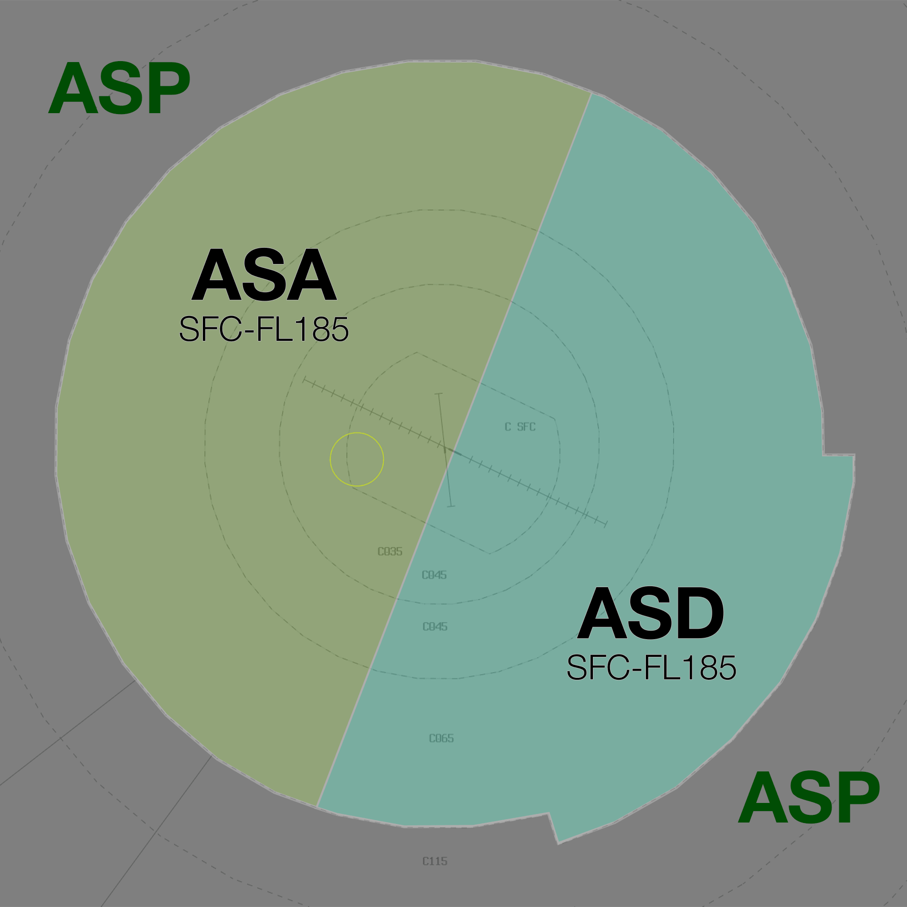
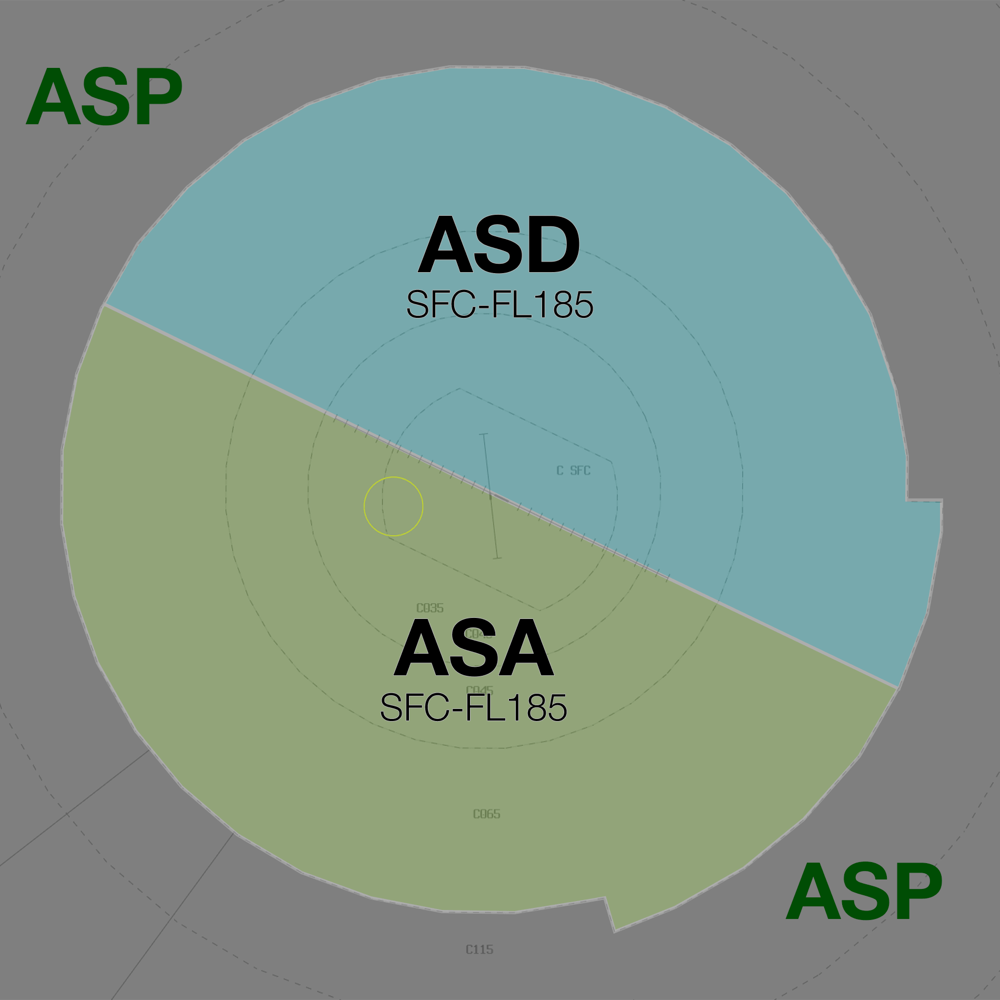

--8<-- "includes/abbreviations.md"

## Temporary Positions
For the duration of the event, YBAS will be reclassified as a Class C Radar Tower. **AS ADC is not responsible for any airspace**.

All existing Class D airspace is reclassified as Class C and two temporary surveillance TCU units are responsible for the airspace within 36 DME (39 DME to the southeast) from `SFC` to `F185`. 

| Name                   | Callsign              | Frequency   | Login ID      |
| ---------------------- | --------------------- | ----------- | ------------- |
| **Alice Springs APP**  | **Alice Approach**    | **119.800** | **AS_APP**    |
| **Alice Springs DEP**  | **Alice Departures**  | **122.400** | **AS_DEP**    |

### Airspace Reclassification
All Class D airspace within 15 DME is reclassified as Class C, extending from their respective bases to the base of the overlying Class C airspace.

## Airspace Division
### Runway 12
The TMA is split perpendicular to the extended runway centreline.

<figure markdown>
{ width="700" }
<figcaption>TMA Split</figcaption>
</figure>

### Runway 30
The TMA is split along the extended runway centreline.

<figure markdown>
{ width="700" }
<figcaption>TMA Split</figcaption>
</figure>

## Arrival Procedures
ASW will transfer all event aircraft to **AS APP** cleared direct `LISZT` (for ILS runway 12) or `AS2EC` (for RNP-Z runway 30), assigned `A090`. [Voiceless coordination](#asw-to-as-tcu) is in place for aircraft meeting this criteria.

All IFR aircraft shall be processed via the instrument approach mentioned above.

**AS ADC** is temporarily reclassified as a Class C radar tower and is not responsible for any airspace. Aircraft shall be transferred to ADC once established on final.

## Departure Procedures
Normal [SID selection](../../../aerodromes/procedural/alice.md#sid-selection) shall apply to all departures. Event aircraft will be assigned the **KALUG SID**.

With runway 30 in use, the SID track interferes with the RNP-Z final approach course. **AS DEP** may utilise the airspace in the [southeast quadrant](#southeast-quadrant) of the TMA provided any departing aircraft is established above any arriving aircraft. AS DEP is responsible for maintaining separation assurance between these aircraft.

!!! tip
    It may be necessary to vector departing aircraft to the north of the RNP track until adequate vertical separation assurance exists. Once clear of conflict, these aircraft should be cleared direct to `KALUG`.

**AS DEP** shall transfer event aircraft to ASP assigned the lower of `F180` or `RFL`.

## WorldFlight Teams
WorldFlight Teams will be highlighted by default and should receive priority at all stages of flight.

<figure markdown>
{ width="400" }
<figcaption>WF Team Highlight</figcaption>
</figure>

## Coordination
### AS ADC
#### Auto Release
Available for all aircraft:

- Assigned the lower of `A060` or `RFL`; and
- Assigned the **KALUG** SID

Next coordination is required for all non-event aircraft.

### AS TCU
#### Southeast Quadrant
AS APP has no restrictions or requirements for departing aircraft operating to the southeast of the aerodrome, provided they are established above any arriving aircraft.

**AS DEP** is responsible for maintaining separation assurance between these aircraft.

### AS TCU to ASP
Event aircraft departing YBAS shall be handed directly from AS TCU to **ASP**.

Voiceless for all aircraft:

- Assigned the lower of `F180` or the `RFL`; and  
- Tracking via **KALUG**

All other aircraft going to ASP CTA will be **Heads-up** Coordinated.

### ASW to AS TCU
Voiceless for all aircraft:

- Assigned `A090`; and
- Tracking via either `LISZT` or `AS2EC`

All other aircraft going to AS TCU CTA will be **Heads-up** Coordinated.

!!! note
    When ASP is online, the airspace immediately west of the AS TMA is released to ASW to facilitate YBAS arrivals. All event aircraft inbound to YBAS will be transferred directly from ASW to AS TCU.