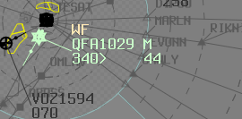

--8<-- "includes/abbreviations.md"

## Airspace Division
Standard airspace divisions will be used for the event. The airspace shall be divided between two Departures controllers, as per below:

| Departures South (SDS) | Departures North (SDN) |
| ---------------------- | ---------------------- |
| SDS                    | SDN                    |
| SAS                    | SAN                    |
| SWA                    | SRA                    |

!!! note
    Only one Departures controller will be required in the event of a single runway mode at YSSY.

## Departure Procedures
Aircraft departing from runways 16R/34L will be assigned the procedural SID terminating at KADOM.

Aircraft departing from runways 16L/34R will be assigned the **SY (RADAR)** SID with the standard assignable heading. These aircraft shall be vectored to the north of YSSY and handed to **ARL** on heading 310. 

## WorldFlight Teams
WorldFlight Teams will be highlighted by default and should receive priority at all stages of flight.

<figure markdown>
{ width="400" }
<figcaption>WF Team Highlight</figcaption>
</figure>

## Coordination
### SY ADC
#### Auto Release
Standard as per [YSSY Local Instructions](../../../../../aerodromes/classc/sydney/#auto-release).

### ARL
Voiceless for all aircraft:

- Assigned the lower of `F280` or the `RFL`; and  
- Assigned **H310**

All other aircraft going to ARL CTA will be **Heads-up** Coordinated.

!!! tip
    Ensure headings are [annotated appropriately](../../../../../client/annotations/#route-and-positions) in the aircraft's label data field, to provide situational awareness to receiving controllers.

    Controllers may choose to alter the voiceless heading to compensate for wind or other factors.