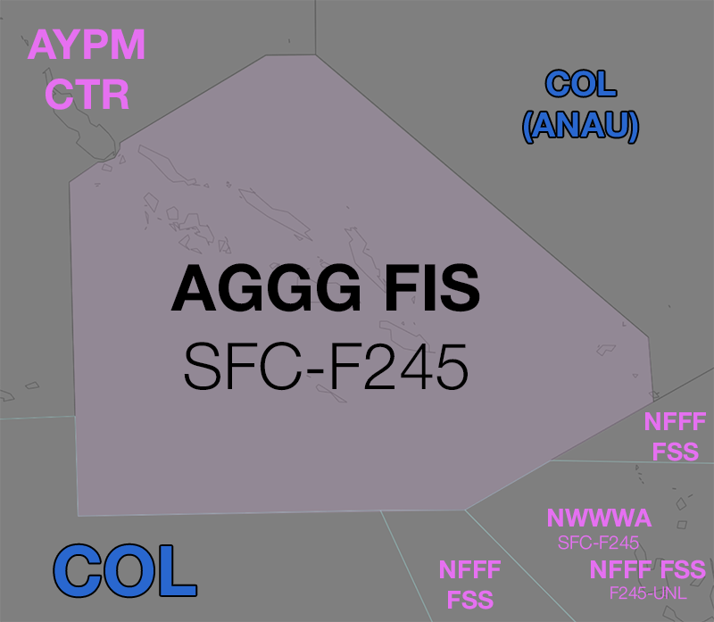

--8<-- "includes/abbreviations.md"

## Positions

| Name               | ID           | Callsign             | Frequency            | Login ID       |
| ------------------ | ------------ | -------------------- | -------------------- | -------------- |
| **Honiara FIS**    | **AGGG FIS** | **Honiara Radio**    | **124.625 (11.339)** | **AGGG_FSS**   |

## Airspace
<figure markdown>
{ width="700" }
  <figcaption>AGGG Airspace</figcaption>
</figure>

AGGG FIS is responsible for the provision of FIS in Class G airspace in the AGGG FIR, `SFC-F245`.
 
## Surveillance Coverage
There are no radar services in AGGG's airspace. The sector is entirely [procedural](../../../separation-standards/procedural/).

## Coordination
### TSN(COL)/NVVVA
#### Entering CTA
Heads-up coordination is required for **all aircraft** entering TSN(COL)/NVVVA CTA from AGGG Glass G airspace. Heads-up coordination must be completed prior to handoff however, best practice is to complete the coordination as soon as possible.

!!! phraseology
    **AGGG FIS** -> **COL**: "QFA358 departed AGGH time 15, estimate RIPNA time 20"  
    **COL** -> **AGGG FIS**: "QFA358."  

##### Leaving CTA
All other aircraft coming from TSN(COL)/NVVVA CTA will be **heads-up** Coordinated to AGGG FIS. Upon receiving coordination, AGGG GIS should provide a traffic statement.

!!! phraseology
    **COL** -> **AGGG FIS**: "ANG80, left `F360` descending. Estimate PAKMI time 25"  
    **AGGG FIS** -> **COL**: "ANG80, no reported IFR traffic"  
	**COL** -> **AGGG FIS**: "Copy, no traffic"  

### AYPM/NFFF (Oceanic)
It is not possible for aircraft transiting from AGGG airspace to directly enter AYPM or NFFF controlled airspace; all transits will remain OCTA. As per [standard OCTA coordination procedures](../../controller-skills/coordination/#octa-coordination) no coordination is required, provided there are no changes to route or level within **5 mins** to boundary.

<!---## Charts--->
