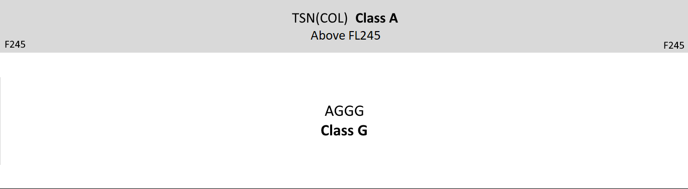

--8<-- "includes/abbreviations.md"

## Altimetry

### Transition Altitude 

In the Honiara FIR the transition altitude is 13,000 ft (`A130`).

### Transition Level

In the Honiara FIR the transition level is 15,000 ft (`F150`).

## Airspace
[AGGG FIS](./honiara) is responsbile for the provision of FIS in the Class G airspace below `F245`. All ATS above `F245` is provided by [TSN (COL)](../../oceanic/TSN/#coral-col).

<figure markdown>
{ width="700" }
  <figcaption>AGGG airspace diagram</figcaption>
</figure>