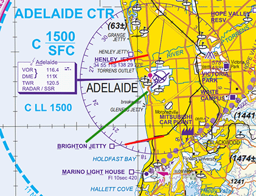
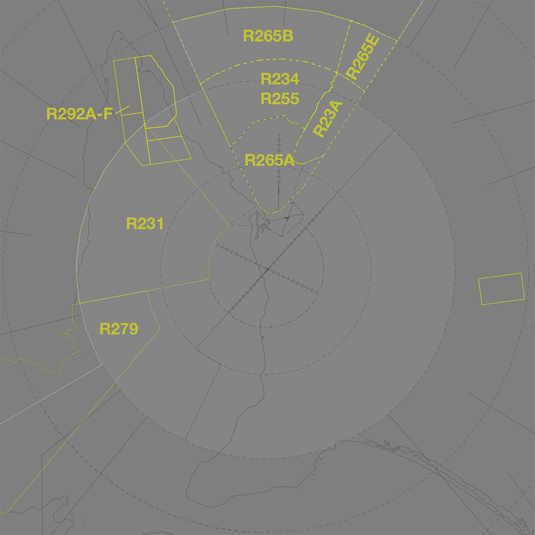

--8<-- "includes/abbreviations.md"

## Positions

| Name                          | ID      | Callsign                | Frequency   | Login ID      |
| ----------------------------- | ------- | ----------------------- | ----------- | ------------- |
| **Adelaide Approach East**    | **AAE** | **Adelaide Approach**   | **118.200** | **AD_APP**    |
| Adelaide Approach West :material-information-outline:{ title="Non-standard position"}  | AAW | Adelaide Approach  | 124.200 | AD-W_APP |
| Adelaide Radar :material-information-outline:{ title="Non-standard position"}          | AAR | Adelaide Centre    | 130.450 | AD-R_APP |

!!! abstract "Non-Standard Positions"
    :material-information-outline: Non-standard positions may only be used in accordance with [VATPAC Air Traffic Services Policy](https://vatpac.org/publications/policies){target=new}.  
    Approval must be sought from the **bolded parent position** prior to opening a Non-Standard Position, unless [NOTAMs](https://vatpac.org/publications/notam){target=new} indicate otherwise (eg, for events).

## Airspace
The vertical limits of the AD TCU are `SFC` to `F245`.

### Reclassifications
=== "PF CTR"
    PF CTR reverts to Class G when **PF ADC** is offline, and is administered by AAR.

    See also: [PF ADC Offline](#pf-adc-offline).

=== "ED CTR"
    ED CTR reverts to Class G when **ED ADC** is offline, and is administered by AAR.  

### Airspace Division
!!! note
    The following diagram does not include non AD TCU areas of responsibility such as PF CTR or ED CTR

<figure markdown>
{ width="700" }
  <figcaption>AD TCU Structure</figcaption>
</figure>

#### Adelaide Radar (AAR)
AAR is responsible for the provision of FIS in Class G airspace within the AD TMA. It is a role normally performed by AAE but can be delegated to any TMA controller. The position is designed to reduce the workload of other TMA positions by obtaining a pilot's request, identifying them, performing any necessary coordination, then handing them to the relevant controller who will issue clearance if appropriate. [Explicit coordination requirements](#between-aar-and-tcu) exist between AAR and other TCU positions.

!!! example
    During a busy event, AAE is experiencing a high workload and wishes to delegate the AAR role to AAW controller who isn't as busy.
    
#### SUA in Enroute Airspace
Military operations taking place in SUA in enroute airspace are outside the jurisdiction of AD TCU.

Upon receiving [airways clearance coordination from ED SMC](#smc-to-tcu) of an aircraft intending to operate in a currently inactive SUA in enroute airspace, AD TCU must give **heads up** coordination to relevant enroute controllers.

This gives the enroute controller sufficient time to assess the request, make necessary adjustments to any aircraft in the area currently, and activate the SUA; or alternately to refuse the activation request before the aircraft is in the air.

!!! phraseology
    *STKR11 is requesting clearance to operate in the R265A-F restricted area, up to `F450`.*  
    **ED SMC** -> **AAW**: "STKR11 requests clearance to R265A-F”  
    **AAW** -> **ED SMC**: "Standby, call you back."  
     
    **AAW** -> **AUG**: "On the groud YPED, STKR11, requests activation of R265A-F `SFC-F450`, from 0300 until 0500.”  
    **AUG** -> **AAW**: "STKR11, expect activation of R265A-F `SFC-F450` at 0300 until 0500."   
    **AAW** -> **AUG**: "STKR11."   
      
    **AAW** -> **ED SMC**: "STKR11, clearance approved."   
    **ED SMC** -> **AAW**: "Clearance approved, STKR11"  

!!! note
    The requirement to coordinate activation of an SUA is in **addition** to existing coordination requirements. [**Heads-up** coordination](#departures) is still required for these aircraft if they do not meet the voiceless coordination criteria.

## Local Procedures 
### Scenic Coastal Flights
VFR aircraft may transit the control zone tracking coastal north or southbound, generally at `A005`. **AD TCU** is responsible for ensuring these aircraft remain separated from aircraft arriving/departing at YPAD and may delegate this responsibility to **AD ADC**.  

Coordinate the aircraft with ADC, including the use of the appropriate clearance limit in the table below, then issue airways clearance. Before the aircraft reaches the clearance limit, transfer them to ADC who will manage their transit of the extended runway centreline.  The clearance limits in the table below will ensure that coastal aircraft remain clear of the runway 05 approach path and runway 23 departure/missed approach path. 

| Direction of Travel | Clearance Limit |
| ---- | ---- |
| Northbound | BTJ |
| Southbound | HNLY |

<figure markdown>
{ width="500" }
  <figcaption>Clearance Limits (red) and Approach/Departure Path (green)</figcaption>
</figure>

!!! phraseology
    **CEY:** "Adelaide Approach, CEY, Cessna 172, 4nm south of PNL, 1,000ft, received charlie, request coastal northbound"  
    **AD TCU:** "CEY, Adelaide Approach, squawk 0542, remain clear of class C airspace"  
    **CEY:** "Squawk 0542, remain OCTA, CEY"  

    **TCU** -> **ADC**: "South of PNL, CEY, for coastal northbound, 500ft, clearance limit BTJ"  
    **ADC** -> **TCU**: "CEY"  

    **AD TCU:** "CEY, identified, cleared coastal offshore northbound, not above 500ft, clearance limit BTJ"  
    **CEY:** "Cleared coastal offshore northbound, not above 500ft, clearance limit BTJ, CEY"  

    *Before CEY reaches BTJ:*  
    **AD TCU:** "CEY, contact Adelaide Tower, 120.5"  
    **CEY:** "120.5, CEY"

Once the aircraft has transited the extended runway centreline and is clear of potential conflict with YPAD, ADC will transfer them back to the TCU.

### Special Use Airspace
#### Edinburgh SUA
There are multiple [restricted areas](../../controller-skills/sua/#restricted-areas) within the TMA associated with military operations at YPED.

<figure markdown>
{ width="700" }
  <figcaption>Edinburgh SUA in the AD TMA</figcaption>
</figure>

**ED SMC** will coordinate the [activation of these SUAs](#smc-to-tcu) with ED TCU **prior** to any activity.

When activated above `A045`, the Edinburgh SUAs disrupt civilian traffic arriving YPAD via the **BUGSU STAR, KLAVA Transition**.

##### R231 Adelaide
The **R231 Adelaide** [restricted area](../../controller-skills/sua/#restricted-areas) is located in uncontrolled airspace over Spencer Gulf, `SFC-A025`. It is [automatically activated](../../controller-skills/sua/#activating-sua-in-vatsys) daily according to its scheduled operating hours.

## Departure and Arrival Procedures
### Visual Approaches

Adelaide utilises visual approaches extensively to help facilitate a smooth sequence of jet and non-jet arrivals. There are two different configurations of visual arrivals used, depending on the cloud base.

#### Jets
Jet aircraft will be assigned the relevant Alpha or Zulu STAR to Runway 23 or 05.

#### Non-Jets
Non-Jet aircraft will be processed via a combination of:

- Non-jet Victor STARs for VSA
- Alpha/Zulu STARs for IAP
- No STAR, expecting vectors or direct tracking for VSA or IAP

!!! tip
    Refer to the [TBD page](../../enroute/melbourne/TBD/#star-assignment) for more details on the ATIS conditions and feeder fix combinations which will determine how each aircraft is processed.

Non-jet aircraft processed via direct tracking for a VSA should be vectored or cleared as necessary to join a circuit leg (generally final or downwind).

## Offline Towers
### PF ADC Offline
Due to the low level of CTA at YPPF, it is best practice to give airways clearance to aircraft at the holding point, to ensure departing aircraft can have uninterrupted climb.

!!! phraseology
    **ABC**: "Adelaide Approach, ABC, PC12, POB 8, IFR, taxiing YPPF for YPAG, Runway 21R"   
    **AD TCU**: "ABC, Adelaide Approach, Squawk 3601, no reported IFR traffic, report ready at the holding point for airways clearance"  
    **ABC**: "Squawk 3601, wilco, ABC"  

    **ABC**: "ABC, ready Runway 21R"  
    **AD TCU**: "ABC, cleared to YPAG via DOLVU, flight planned route, PF1 departure, climb via SID to `A040`"   
    **ABC**: "Cleared to YPAG via DOLVU, flight planned route, PF1 departure, climb via SID to `A040`, ABC"  
    **AD TCU**: "ABC, assigned heading right 360, report airborne"  
    **ABC**: "Assigned right 360, wilco, ABC"

## Coordination
### Enroute
#### Departures
Voiceless for all aircraft:
 
- Tracking via a Procedural SID terminus; and  
- Assigned the lower of `F240` or the `RFL`

!!! note
    Aircraft are *not required* to be tracking via the **SID procedure**, simply tracking via any of the terminus waypoints (regardless of *departure airport* or *assigned SID*) is sufficient to meet the criteria for **voiceless coordination**.

All other aircraft going to TBD CTA must be **Heads-up** coordinated by AD TCU prior to the boundary.

!!! phraseology
    **AD TCU** -> **TBD**: "PFY1234, request DCT LOLLS"  
    **TBD** -> **AD TCU**: "PFY1234, concur DCT LOLLS"  

#### Arrivals
Voiceless for all aircraft:

- With ADES **YPAD**; and  
- Assigned a STAR; and  
- Assigned `A090`

All other aircraft coming from TBD CTA will be **Heads-up** coordinated to AD TCU.

### AD ADC
#### Auto Release
[Next](../controller-skills/coordination.md#next) coordination is **not** required to AD TCU for aircraft that are:   

  - Departing from a runway nominated on the ATIS; and  
  - Assigned the standard assignable level; and  
  - Assigned a **Procedural** SID

All other aircraft require a Next call to AD TCU.

The standard assignable level from AD ADC to AD TCU is:  

| Aircraft | Level |
| -------- | ----- |
| Jets | `A050` |
| Non-Jets | The lower of `A040` and `RFL` |

### AD TCU Internal
All aircraft transiting between internal AD TCU boundaries must be heads-up coordinated.

!!! phraseology
    **AAW** -> **AAE**: "via AD, FD123"  
    **AAE** -> **AAW**: "FD123, A090"   

Boundary coordination is not required between AAW and AAE for aircraft arriving or departing tracking via the 05/23 extended centreline.

#### Between AAR and TCU
Standard [Radar to TCU](../controller-skills/coordination.md#radar-position-tcu-controllers) coordination for each aircraft transiting between Class G and CTA (or vice versa).

### PF ADC
#### Airspace
PF ADC is responsible for the Class D airspace in the PF CTR `SFC` to `A015`.

Refer to [Reclassifications](#reclassifications) for operations when PF ADC is offline.

#### Departures
[Next](../controller-skills/coordination.md#next) coordination is required from PF ADC to AD TCU for all aircraft **entering AD TCU CTA**.

The standard assignable level from **PF ADC** to **AD TCU** is:

| Aircraft | Level |
| ----- | ---- |
| All | The lower of `A030` and `RFL` |

#### Arrivals/Overfliers
AD TCU will heads-up coordinate arrivals/overfliers from Class C to PF ADC prior to **5 mins** from the boundary.  
IFR aircraft will be cleared for the coordinated approach (Instrument or Visual) prior to handoff to PF ADC, unless PF ADC nominates a restriction.  
VFR aircraft require a level readback.

!!! phraseology
    **AAW** -> **PF ADC**: "via PAL, YTS"  
    **PF ADC** -> **AAW**: "YTS, A010"

### ED ADC
#### Departures
[Next](../controller-skills/coordination.md#next) coordination is required from ED ADC to AD TCU for all aircraft.

The standard assignable level from **ED ADC** to **AD TCU** is:

| Aircraft | Level |
| -------- | ----- |
| All | The lower of `A040` and `RFL` |

### SMC to TCU
The controller assuming responsibility of **SMC** shall give [heads-up](../../../controller-skills/coordination/#airways-clearance) coordination to AD TCU (or the enroute controller responsible for the AD TCU) prior to the issue of a clearance to an aircraft intending to operate in an SUA that **has not** been activated. 

**AD TCU** shall coordinate with the relevant enroute controller responsible for the airspace to determine whether the airspace will be activated and then approve the clearance to SMC.

!!! phraseology
    **ED SMC** -> **AAW**: "STKR11 requests clearance to R265B"  
    **AAW** -> **ED SMC**: "I'll call you back"  

    **AAW** -> **AUG**: "On the ground YPED, STKR11, requests activation of R265A-F `SFC-F450`, from 0300 until 0500.”  
    **AUG** -> **AAW**: "STKR11, expect activation of R265A-F `SFC-F450` at 0300 until 0500."   
    **AAW** -> **AUG**: "STKR11." 

    **AAW** -> **ED SMC**: "STKR11, clearance approved."  

#### Arrivals/Overfliers
AD TCU must [Heads-up](../controller-skills/coordination.md#heads-up) coordinate all arrivals/overfliers to ED ADC.

!!! phraseology
    **AD TCU** -> **ED ADC**: "To the west, PLE, for the ILS-Z"  
    **ED ADC** -> **AD TCU**: "PLE, ILS-Z"

Inbound aircraft must be cleared for an instrument or visual approach prior to handoff to ED ADC, unless ADC nominates a restriction.
