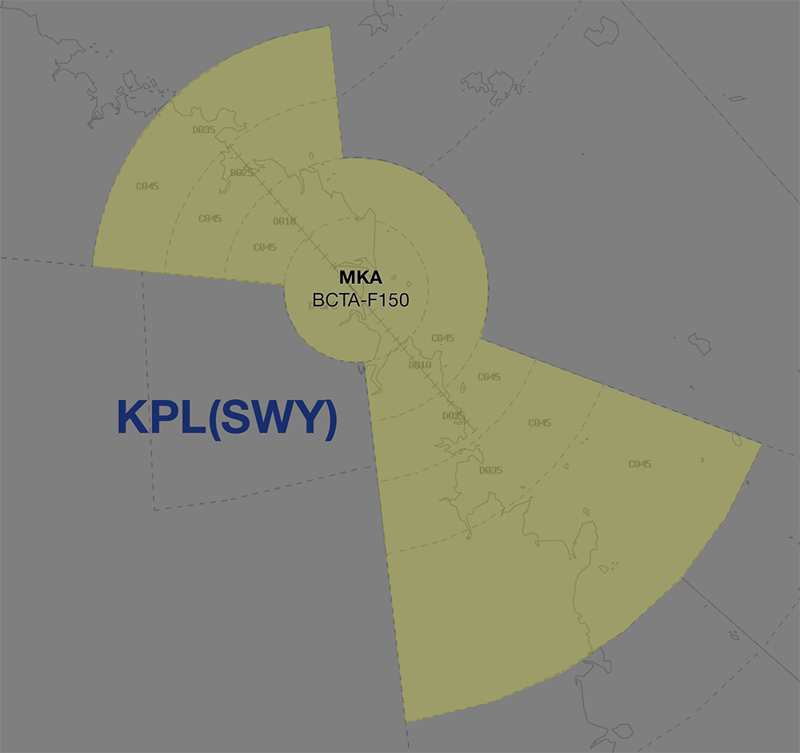
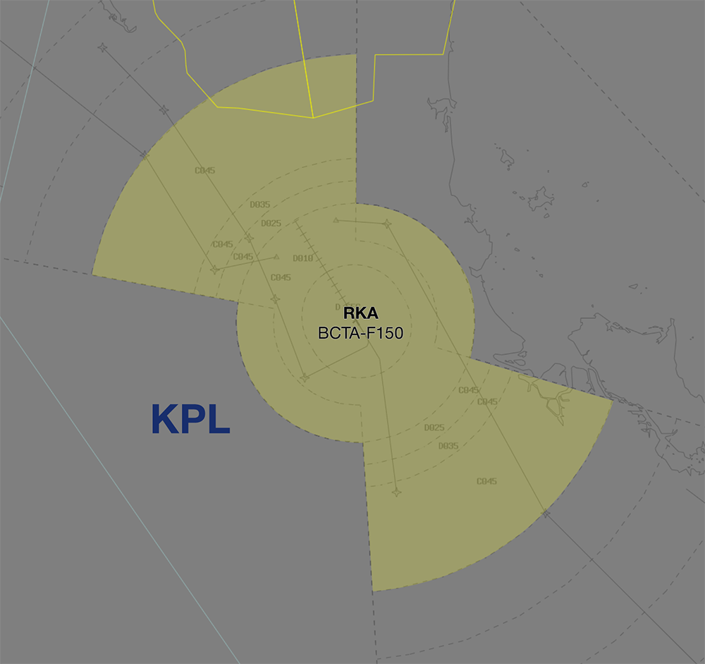
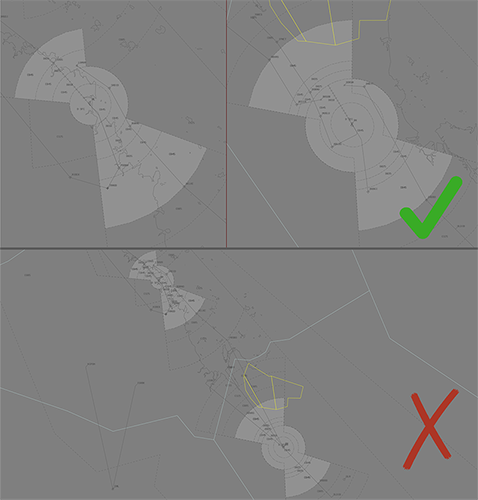
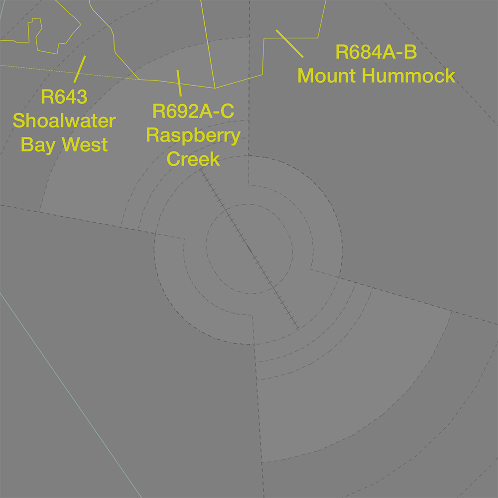

--8<-- "includes/abbreviations.md"

## Positions

| Name                          | ID      | Callsign                | Frequency   | Login ID      |
| ----------------------------- | ------- | ----------------------- | ----------- | ------------- |
| **Mackay Approach**           | **MKA** | **Coral Approach**      | **125.650** | **MK_APP**    |
| **Rockhampton Approach**      | **RKA** | **Coral Approach**      | **123.750** | **RK_APP**    |

## Airspace
The vertical limits of the Coral TCUs are `SFC` to `F150`.

### Airspace Division
#### MK TCU

**MKA** owns the airspace contained within the MK TCU 'keyhole'

<figure markdown>
{ width="952" }
  <figcaption>MK TCU Structure</figcaption>
</figure>

MK ADC owns the Class D airspace within MK CTR `SFC` to `A010`.

#### RK TCU

**RKA** owns the airspace contained within the RK TCU 'keyhole'

<figure markdown>
{ width="952" }
  <figcaption>RK TCU Structure</figcaption>
</figure>

RK ADC owns the Class D airspace within RK CTR `SFC` to `A010`.  

### Extending
MKA may extend to RKA and vice versa, callsigns remain the same. See [Controller Skills](../controller-skills/extending.md) for details.

!!! tip
    When setting up vatSys while providing coverage to RKA and MKA, it is recommended that you have seperate air displays open for MKA and RKA.
    <figure markdown>
    
    </figure>
	
### Restricted Area Activations
There are no [restricted areas or MOAs](../../controller-skills/sua) activated by default when RKA or MKA are online.

#### SUA in Enroute Airspace
YBRK is regularly used by military aircraft operating within the [Shoalwater Bay Military Training Area](../../enroute/brisbane/KPL/#shoalwater-bay-sua).

Upon receiving [airways clearance coordination from SMC](#rk-smc-to-rk-tcu) of an aircraft intending to operate in a currently inactive SUA, RK TCU must give **heads up** coordination to relevant enroute controllers.

This gives the enroute controller sufficient time to assess the request, make necessary adjustments to any aircraft in the area currently, and activate the SUA; or alternately to refuse the activation request before the aircraft is in the air.

!!! phraseology
    *PATR11 is requesting clearance to operate in the M678 restricted area.*  
    **RK SMC** -> **RKA**: "PATR11 requests clearance to M678.”  
    **RKA** -> **RK SMC**: "Standby, call you back."  
    
    **RKA** -> **KPL**: "On the groud YBRK, PATR11, requests activation of M678 `A085-F240`, from 0300 until 0500.”  
    **KPL** -> **RKA**: "PATR11, expect activation of M678 `A085-F240` at 0300 until 0500."   
    **RKA** -> **KPL**: "PATR11."   
    
    **RKA** -> **RK SMC**: "PATR11, clearance approved."   
    **RK SMC** -> **RKA**: "Clearance approved, PATR11"  

!!! note
    The requirement to coordinate activation of an SUA is in **addition** to existing coordination requirements. [**Heads-up** coordination](#auto-release) is still required for these aircraft if they do not meet the voiceless coordination criteria.

## Local Procedures
### Special Use Airspace
<figure markdown>
{ width="700" }
  <figcaption>Notable SUA in the RK TMA</figcaption>
</figure>

###R684A-B Mount Hummock and R692A-C Raspberry Creek
The R684A-B Mount Hummock and R692A-C Raspberry Creek [restricted areas](../../controller-skills/sua/#restricted-areas) straddle the border of the RK TCU and KPL airspace. 

It is predominantly used for military training operations, including operations at the Samuel Hill (YSMH).

### Training Area Clearances
The D706 Rockhampton [danger area](../../../controller-skills/sua/#danger-areas) is a commonly used training area south-west of YBRK.

<figure markdown>
{ width="700" }
</figure>

Aircraft departing to the training area will be cleared to track to, and operate within, the training area not above `A045` by RK ADC. This clearance gives aircraft permission depart the RK CTR, and transit to the D764 danger area via SPS.

## Coordination
### Enroute
#### Departures
Voiceless for all aircraft:

- With ADEP **YBMK**  
    - Tracking via **CLIFT** or **MUNAR**; and  
    - Assigned the lower of `F150` or the `RFL`  
- With ADEP **YBRK**  
    - Tracking via **BUDGI** or **TARES**; and  
    - Assigned the lower of `F150` or the `RFL`

All other aircraft going to SWY/KPL CTA must be **Heads-up** Coordinated by MKA/RKA.

!!! phraseology
    **RKA** -> **KPL**: "QFA114, with your concurrence, will be assigned F130, for my separation with ZYX"  
    **KPL** -> **RKA**: "QFA114, concur F130"  

#### Arrivals
Voiceless for all aircraft:

- With ADES **YBMK**    
    - Assigned the **DAGSI** or **WELKE** STAR; and  
    - Assigned `A090`  
- With ADES **YBRK**; and  
    - Assigned the **ABVAS** or **DADBO** STAR; and  
    - Assigned `A090`

All other aircraft coming from SWY/KPL CTA will be **Heads-up** Coordinated to MKA/RKA.

### MK/RK ADC
#### Airspace
MK ADC is responsible for the Class D airspace in the MK CTR `SFC` to `A010`.

RK ADC is responsible for the Class D airspace in the RK CTR `SFC` to `A010`.

#### Auto Release
[Next](../controller-skills/coordination.md#next) coordination is **not** required to MKA/RKA for aircraft that are:  

- Departing from a runway nominated on the ATIS; and  
- Assigned the standard assignable level; and  
- Assigned a **Procedural** SID; or  
- Not entering MKA/RKA CTA

The standard assignable level from **MK/RK ADC** to **MKA/RKA** is:

| Aircraft | Level |
| ------ | ----- |
| All | The lower of `A060` and `RFL` |

!!! phraseology
    **MK ADC** -> **MKA**: "Next, ABC, runway 14"  
    **MKA** -> **MK ADC**: "ABC, Heading 150 Visual, unrestricted"  
    **MK ADC** -> **MKA**: "Heading 150 Visual unrestricted, ABC"

The TCU controller can suspend/resume Auto Release at any time, with the concurrence of **ADC**.

The standard assignable level from MK/RK ADC to MKA/RKA is the lower of `A060` or the `RFL`.

### RK SMC to RK TCU
The controller assuming responsibility of **RK SMC** shall give [heads-up](../../../controller-skills/coordination/#airways-clearance) coordination to RKA (or the enroute controller responsible for the RK TCU) prior to the issue of a clearance to an aircraft intending to operate in an SUA that **has not** been activated. 

!!! phraseology
    **RK SMC** -> **RKA**: "PATR11 requests clearance to M678.”  
    **RKA** -> **RK SMC**: "PATR11, clearance approved."

#### Arrivals
COR TCU will coordinate all YBMK and YBRK arrivals to ADC prior to **5 mins** from the boundary. This coordination shall be as per [Standard Heads-up format](../../controller-skills/coordination/#heads-up), with the addition of:

- Runway, if other than duty runway  
- Approach type, unless specifically nominated on the ATIS  
- IFR Circuit joining instructions, if not on Straight-in instrument approach

!!! phraseology
    **RKA** -> **RK ADC**: "via ABVAS, DJU, for the VOR-A"  
    **RK ADC** -> **RKA**: "DJU, VOR-A"