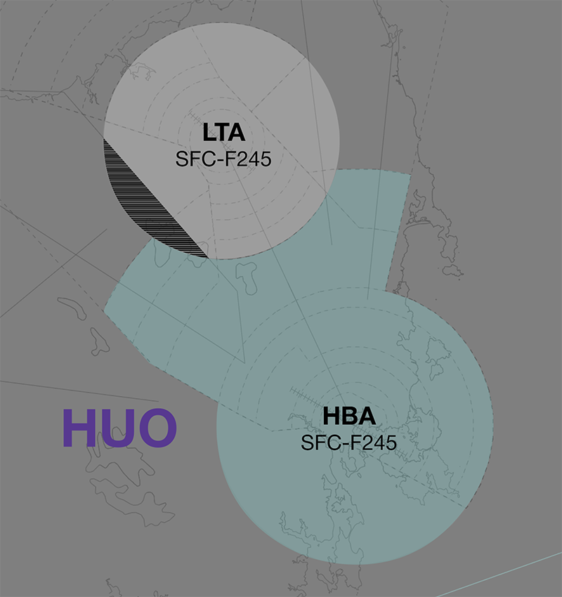

--8<-- "includes/abbreviations.md"

## Positions

| Name                          | ID      | Callsign                | Frequency   | Login ID      |
| ----------------------------- | ------- | ----------------------- | ----------- | ------------- |
| **Hobart Approach**           | **HBA** | **Hobart Approach**     | **125.550** | **HB_APP**    |
| **Launceston Approach**       | **LTA** | **Launy Approach**      | **123.800** | **LT_APP**    |

## Airspace
The vertical limits of the Tasmanian TCUs are `SFC` to `F245`.

<figure markdown>
{ width="952" }
  <figcaption>Tasmania TCU Structure</figcaption>
</figure>

### Airspace Division
#### LT TCU
**LTA** owns the airspace `SFC` to `F245` within a 30nm radius of the LT VOR. LT ADC owns the Class D airspace within LT CTR `SFC` to `A015` when open.  

##### LTA Release to HUO
The Airspace on and west of the IRSOM-MORGO track `F125`-`F245` (shaded in the diagram above) is permanently released from LTA to HUO, unless coordinated otherwise.

#### HB TCU
**HBA** owns the airspace `SFC` to `F245` within the remainder of the Tasmania TMA (shown below). HB ADC owns the Class D airspace within HB CTR `SFC` to `A015` (north of runway centreline) and `A025` (south of runway centreline) when open. 

### Extending
HBA may extend to LTA and vice versa, callsigns remain the same. See [Controller Skills](../controller-skills/extending.md) for details.

## Departure and Arrival Procedures
### YMLT
Visual approaches are preferred into YMLT. 

If instrument approaches are nominated on the ATIS, HUO will reroute inbound IFR aircraft via the following waypoints:   

| Duty Runway | Tracking Via    | Amended Routing            |
| ----------- | ----------------| -------------------------- |
| RWY 14R     | IRSOM NUNPA  | LT2ND LT2NG             |
| RWY 32L     | IRSOM NUNPA  | NODAS LT2SC ELREL LT2SA |

These routes keep arrivals within CTA and away from the departure streams.

!!! tip
    In some situations, it may be beneficial to process aircraft from the north via the DGA/visual approach for a circuit join to RWY 32L, as a form of track shortening. See [Local Knowledge](#local-knowledge) for more.

    Likewise, it may be necessary to process aircraft via the RNP (and above routing) for sequencing/separation. Coordination with HUO must take place in either case.
	
### YMHB
All aircraft should be kept on SIDs and STARs. If due to operational requirements or routing, an aircraft is unable to accept the SID or STAR, voice coordination with HUO will be required.

#### YCBG
Aircraft inbound to YCBG who will track via the HBA CTA should be issued an airways clearance by HBA, then passed to HB ADC when appropriate. HBA must coordinate any clearance limits issued to HB ADC. 

Aircraft inbound to YCBG who will track directly from Class G airspace to the CTR should contact HB ADC for clearance.

## Coordination
### Enroute
#### Departures
Voiceless for all aircraft:

- Assigned the lower of `F240` or the `RFL`; and  
- Tracking via a Procedural SID terminus

All other aircraft going to HUO CTA must be **Heads-up** coordinated by TAS TCU prior to the boundary.

!!! phraseology
    **LTA** -> **HUO**: "via IRSOM, QFA114, with your concurrence, will be assigned `F150`, for my separation with ZYX"  
    **HUO** -> **LTA**: "QFA114, concur F150"

#### Arrivals
Voiceless for all aircraft:

- With ADES **YMLT** 
    - Tracking from **IRSOM** or **NUNPA**  in accordance with [Departure and Arrival Procedures](#ymlt), or DCT **LT**; and  
    - Assigned `A090`  
- With ADES **YMHB** 
    - Assigned a STAR; and  
    - Assigned `F130`   

All other aircraft coming from HUO CTA will be **Heads-up** coordinated to TAS TCU.

### HB ADC
#### Airspace
HB ADC owns the Class D airspace in the HB CTR `SFC` to `A015` north of the runway centreline and `A025` south of the runway centreline. HBA owns the Class D and C airspace above these levels.

#### Departures
[Next](../controller-skills/coordination.md#next) coordination is **not** required to HBA for aircraft that are:   

- Departing from a runway nominated on the ATIS; and  
- Assigned the standard assignable level; and  
- Assigned a SID; or  
- Not entering HBA CTA

All other aircraft require a 'Next' call to HBA.

!!! note
    All departures from YCBG who will enter the HBA CTA will be Next coordinated by ADC.

The standard assignable level from **HB ADC** to **HBA** is:  

| Flight Rules | Level |
| ----- | ----- |
| IFR | `A080` |
| VFR | The lower of `A045` and `RFL` |

##### SMC to TCU
The controller assuming responsibility of **SMC** shall give [heads-up](../controller-skills/coordination.md#airways-clearance) coordination to HBA controller prior to the issue of the following clearances:

- VFR departures entering HBA CTA
- Aircraft using a runway not on the ATIS

#### Arrivals
HBA will coordinate all YMHB & YCBG arrivals to HB ADC prior to **5 mins** from the boundary. This coordination shall be as per [Standard Heads-up format](../../controller-skills/coordination/#heads-up), with the addition of:

- Runway, if other than duty runway  
- Approach type, unless specifically nominated on the ATIS  
- IFR circuit joining instructions, if not on straight-in instrument approach

!!! phraseology
    **HBA** -> **HB ADC**: "via BUSKA, QJE1789, for the ILS"  
    **HB ADC** -> **HBA**: "QJE1789, ILS"

### LT ADC
#### Airspace
LT ADC owns the Class D airspace in the LT CTR `SFC` to `A015`. LTA owns the Class D and C airspace above `A015`.

#### Departures
[Next](../controller-skills/coordination.md#next) coordination is not required to LTA for aircraft that are:   

- Departing from a runway nominated on the ATIS; and  
- Assigned the standard assignable level; and  
- Assigned a SID; or  
- Not entering LTA CTA

All other aircraft require a 'Next' call to LTA. 

The standard assignable level from **LT ADC** to **LTA** is:  

| Flight Rules | Level |
| ------- | ------ |
| IFR | `A080` |
| VFR | The lower of `A045` and `RFL` |

LT ADC shall give [heads-up](../controller-skills/coordination.md#airways-clearance) coordination to LTA controller prior to the issue of the following clearances:  

- VFR departures entering LTA CTA
- Aircraft using a runway not on the ATIS 

#### Arrivals
LTA will coordinate all YMLT arrivals to LT ADC prior to **5 mins** from the boundary. This coordination shall be as per [Standard Heads-up format](../../controller-skills/coordination/#heads-up), with the addition of:

- Runway, if other than duty runway  
- Approach type, unless specifically nominated on the ATIS  
- IFR Circuit joining instructions, if not on Straight-in instrument approach

!!! phraseology
    **LTA** -> **LT ADC**: "via IRSOM, JST416, for the DGA, will join left downwind 32L"  
    **LT ADC** -> **LTA**: "JST416"

### LTA/HBA Internal
All aircraft transiting between internal TAS TCU boundaries must be heads-up coordinated.

!!! phraseology
    **HBA** -> **LTA**: "via LATUM, AM773"  
    **LTA** -> **HBA**: "AM773, F130"